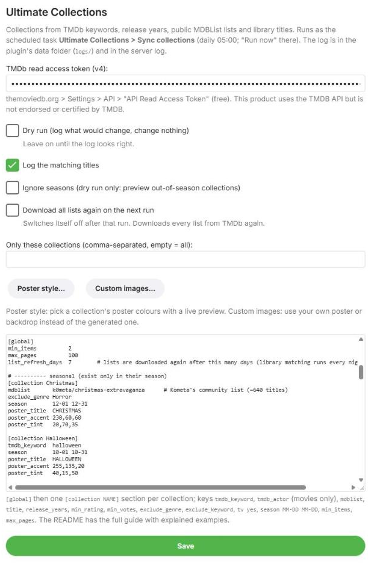
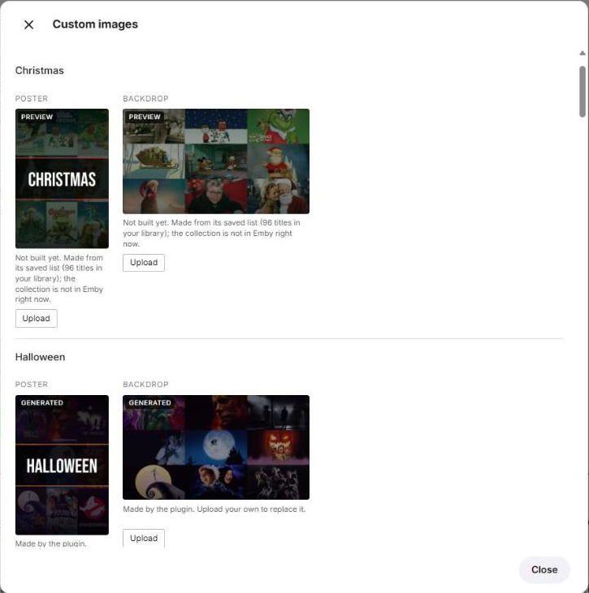
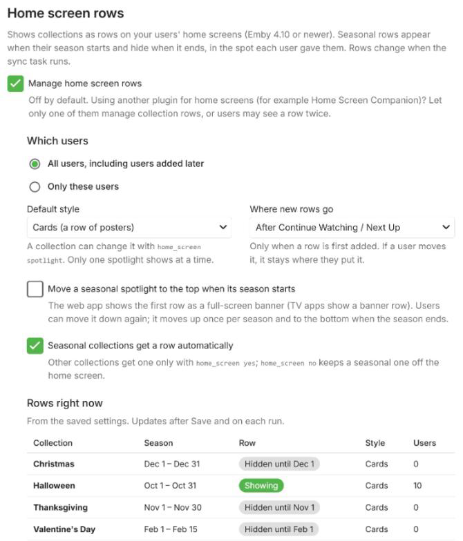
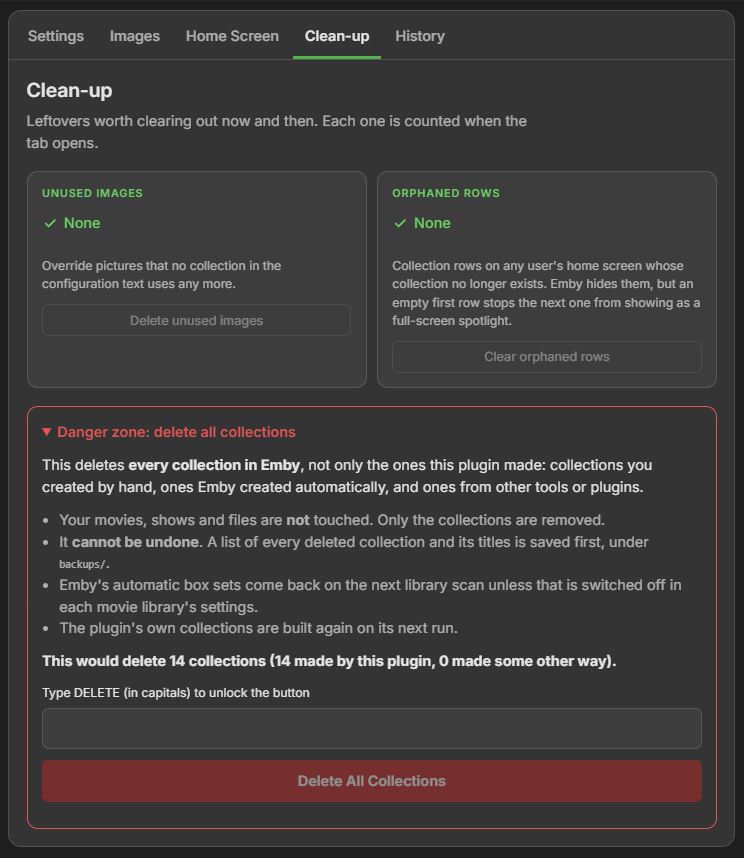

# Ultimate Collections for Emby

**A drop-dead simple collections manager for Emby that keeps itself up to date.**

[](https://buymeacoffee.com/waymirenet)

Ultimate Collections is an Emby Server plugin that builds and maintains **collections** for you: Halloween movies
in October, Christmas movies in December, Time Travel, Dinosaurs, the best movies of the 80's, every Star Trek movie
and series, and anything else you can describe in a few lines of text.

**All it needs is a free TMDb API key. Nothing else:** no subscription, no paid service, no other accounts or keys,
no extra software to install. MDBList lists are public and need no key, and title-based collections work without
the internet at all.

## Why it exists

It was made out of need. The collection tools around for Emby were either too limited, too complicated to set up, or
paid. What was missing was something **drop-dead simple** that would:

- **update itself**: set a collection up once, and new movies join it on their own;
- **schedule collections**: Halloween shows up on October 1st and is gone on November 1st, every year, without
  anyone touching it;
- stay **easy to read and change**: one short block of plain text per collection, no wizards, no databases, no
  dozens of tabs.

That is where the name comes from: **ultimate control over your collections, while keeping it really simple.** You
decide exactly what goes into each collection, when it appears and what its poster looks like, and it fits on a few
lines:

```ini
[collection Halloween]
tmdb_keyword  halloween
season        10-01 10-31
```

That is a complete, working collection: every Halloween movie you own, shown in October, with a generated poster,
updated every night.

## What it does

You write a short description of each collection, and the plugin does the rest every night:

- finds the matching titles using **TMDb keywords, actors, release years and ratings**, **public MDBList lists**, or
  simply **words in the title**;
- puts the ones **you actually own** into an Emby collection, and keeps it up to date as your library grows;
- creates **seasonal collections** only during their season (Halloween in October, Christmas in December) and removes
  them afterwards;
- draws a **poster and a backdrop** for every collection from the artwork of its best-rated movies, or uses
  **your own pictures** if you upload them;
- if you want, puts collections on your users' **home screens** as rows: Halloween shows up there in October and
  goes away in November, in the spot each user gave it.


---

## Contents

1. [Requirements](#requirements)
2. [Installation](#installation)
3. [First run](#first-run)
4. [The settings page](#the-settings-page)
5. [Writing collections: the config language](#writing-collections-the-config-language)
6. [Recipes: examples explained](#recipes-examples-explained)
7. [Posters and backdrops](#posters-and-backdrops)
8. [Home screen rows](#home-screen-rows)
9. [How the nightly sync works](#how-the-nightly-sync-works)
10. [Delete All Collections](#delete-all-collections)
11. [Files and logs](#files-and-logs)
12. [Troubleshooting and FAQ](#troubleshooting-and-faq)
13. [Building from source](#building-from-source)
14. [Support](#support)
15. [Disclaimer](#disclaimer)
16. [Credits](#credits)

---

## Requirements

- **Emby Server 4.10** or newer (built and used on 4.10.1).
- A free **TMDb account** and its **API Read Access Token** (needed for keyword, actor and release-year
  collections; collections that only use `title` or `mdblist` work without TMDb).
- Your movies (and shows) should be identified by Emby, i.e. have a TMDb or IMDb id. That is normally the case when
  Emby's metadata downloaders are on.

The plugin is a single file (`UltimateCollections.dll`). It brings no extra libraries: it uses Emby's own JSON
serializer and Emby's own SkiaSharp for drawing the posters.

---

## Installation

1. Download `UltimateCollections.dll` from the
   [Releases page](https://github.com/jdwaymire/UltimateCollections/releases).
2. Copy it into Emby's `plugins` folder:

   | System | Usual plugins folder |
   |---|---|
   | Linux (package install) | `/var/lib/emby/plugins/` |
   | Windows | `%AppData%\Emby-Server\programdata\plugins\` |
   | Docker | `<your config volume>/plugins/` |

   On Linux, make sure the file belongs to the user Emby runs as, e.g.
   `sudo chown emby:emby /var/lib/emby/plugins/UltimateCollections.dll`.
3. **Restart Emby Server.**
4. Open **Dashboard > Plugins**. *Ultimate Collections* is now in the list.


**Updating:** replace the DLL with the new one and restart Emby. Your settings, saved lists and the list of
collections the plugin owns are kept.

### Getting a TMDb token

1. Create a free account at [themoviedb.org](https://www.themoviedb.org/).
2. Go to **Settings > API** and request an API key (choose "Developer"; a personal, non-commercial use is fine).
3. Copy the long **API Read Access Token** (it starts with `eyJ...`). This is the one the plugin needs, not the
   shorter "API Key".

---

## First run

Start safely: the plugin begins in **dry run** mode, where it only writes to its log what it *would* do.

1. Open **Dashboard > Plugins > Ultimate Collections**.
2. Paste your TMDb token.
3. The big text box already holds a small sample, a **Hacker Movies** collection, just for fun. Keep it, change it,
   or add a few of your own below it, for example:

   ```ini
   [collection Time Travel]
   tmdb_keyword  time travel

   [collection Dinosaurs]
   tmdb_keyword  dinosaur

   [collection Top 80's]
   release_years 1980 1989
   min_rating    7.0
   min_votes     2000
   ```

   Want a head start? [`examples/collections.conf`](examples/collections.conf) has 19 ready-made collections
   (Halloween, Christmas, Time Travel, the best of every decade and more) that you can paste in whole.
4. Leave **Dry run** ticked, tick **Log the matching titles**, and press **Save**.
5. Go to **Dashboard > Scheduled Tasks > Ultimate Collections > Sync collections** and press **Run now** (the
   play button).
6. Read the log (see [Files and logs](#files-and-logs)). You will see lines like:

   ```
   [dry-run] start: 3 collections in config
   library: 3097 movies (3090 with a TMDb id, 3085 with an IMDb id, 3097 distinct ids), 0 series, 0 collections in Emby
   [Time Travel] [dry-run] create with 67 items (list has 948, downloaded (new))
   [Time Travel] matches: 12 Monkeys (1995); Back to the Future (1985); ...
   ```

   "list has 948" is how many titles TMDb knows for that keyword; "67 items" is how many of those you own.
   In dry run the plugin also writes the posters and backdrops it would use into its `previews/` folder, so you can
   look at them first.
7. When the log looks right, **untick Dry run**, Save, and run the task again. Your collections appear in Emby.

From then on the task runs **every day at 05:00** (change the time in Scheduled Tasks if you like).

---

## The settings page



| Setting | What it does |
|---|---|
| **TMDb read access token (v4)** | Your TMDb token (see above). Stored in Emby's plugin settings; never written into URLs or the log. |
| **Dry run** | Log what would change, change nothing. Posters and backdrops are written to `previews/` instead of being set. Leave it on until the log looks right. |
| **Log the matching titles** | Writes every matching title (with its Emby, TMDb and IMDb ids) into the log. Handy while building a collection. |
| **Ignore seasons** | Dry run only. Treats every seasonal collection as if it were in season, so you can preview Christmas in July. |
| **Download all lists again on the next run** | Ignores the saved lists once and downloads everything again. Switches itself off after that run. Normally not needed (see [How the nightly sync works](#how-the-nightly-sync-works)). |
| **Poster style...** | Opens a popup for picking a collection's poster colours with a live preview (see [Posters and backdrops](#posters-and-backdrops)). |
| **Custom images...** | Opens a popup for uploading your own poster or backdrop for a collection, instead of the generated one (see [Your own poster or backdrop](#your-own-poster-or-backdrop)). |
| **Only these collections** | Comma-separated collection names, e.g. `Halloween, Dinosaurs`. The next runs touch only those. Empty = all. Useful while you build or fix one collection. |
| **Collections** | The collection definitions, written in the config language below. |
| **Home screen rows** | Off by default. Puts collections on your users' home screens as rows (see [Home screen rows](#home-screen-rows)). |

Below the form is the **Danger zone** with *Delete All Collections* (see [below](#delete-all-collections)).

---

## Writing collections: the config language

The text box holds plain text with **sections** and **`key value`** lines.

```ini
# Lines starting with # are comments.
[global]                      # settings for all collections
min_items  2

[collection Time Travel]      # one section per collection; the name is what Emby shows
tmdb_keyword  time travel     # key, at least one space, value
```

Rules:

- A section starts with `[global]` or `[collection Name Of The Collection]`. The name may contain spaces and
  punctuation (`[collection Valentine's Day]` is fine). Every collection name must be unique.
- Every other line is `key value`. Keys are lower case. Extra spaces between key and value are fine, so you can line
  them up.
- `#` starts a comment, also at the end of a line **after a space**. That is why colours are written `r,g,b` and not
  `#rrggbb`.
- Every collection needs **at least one source** (see below).
- A mistake (an unknown section, a setting outside a section, a missing source, a keyword TMDb does not know) stops
  the run with an error that names the line or the collection. Nothing is changed in that case; the plugin would
  rather do nothing than fill a collection with the wrong titles.

### [global] settings

| Key | Default | Meaning |
|---|---|---|
| `min_items` | `2` | A collection with fewer matching titles than this is not created (and is removed if it shrinks below it). |
| `max_pages` | `100` | How many TMDb result pages (20 titles each) to read per collection. 100 pages = the top 2,000 titles. |
| `list_refresh_days` | `7` | Downloaded lists are reused for this many days before they are downloaded again. |
| `posters` | `yes` | `posters no` turns off generated posters and backdrops for every collection. |

### Sources: where the titles come from

| Key | Example | Meaning |
|---|---|---|
| `tmdb_keyword` | `tmdb_keyword time travel` | Movies TMDb has tagged with this keyword. Use the exact keyword name (or its numeric id). |
| `tmdb_actor` | `tmdb_actor Tom Hanks` | Movies with this actor in the cast (movies only). Exact name or numeric TMDb person id. |
| `release_years` | `release_years 1980 1989` | All TMDb movies released in these years (both included). Combine with `min_rating` / `min_votes`, or you get thousands. |
| `mdblist` | `mdblist k0meta/christmas-extravaganza` | A **public** list from [mdblist.com](https://mdblist.com). Use the `user/list` part of the list's address. Free, no account needed. |
| `title` | `title Star Trek` | Titles **in your library** whose name contains this text (not case sensitive). Needs no internet at all. |

**Finding keywords:** search for a movie on themoviedb.org, scroll down to **Keywords** on its page, and click one:
the keyword page shows its name and, in the address, its id (`themoviedb.org/keyword/4379-time-travel/movie`
means `time travel`, id `4379`). The plugin matches the name exactly; if it cannot find it, the error lists the
closest names TMDb has.

**Finding MDBList lists:** browse [mdblist.com/toplists](https://mdblist.com/toplists) or search the site; a list at
`https://mdblist.com/lists/k0meta/christmas-extravaganza` is written `mdblist k0meta/christmas-extravaganza`.

### Filters

| Key | Example | Meaning |
|---|---|---|
| `min_rating` | `min_rating 7.0` | Only titles with a TMDb average rating of at least this (0-10). Works with `tmdb_keyword`, `tmdb_actor` and `release_years`. |
| `min_votes` | `min_votes 2000` | Only titles with at least this many TMDb votes. A good way to keep only well-known movies. Same sources as `min_rating`. |
| `exclude_genre` | `exclude_genre Horror` | Leave out titles of this genre. Repeatable. |
| `exclude_keyword` | `exclude_keyword christmas` | Leave out titles with this TMDb keyword. Repeatable. Works with the TMDb sources. |

Genre names (TMDb): Action, Adventure, Animation, Comedy, Crime, Documentary, Drama, Family, Fantasy, History,
Horror, Music, Mystery, Romance, Science Fiction, Thriller, TV Movie, War, Western.

`exclude_genre` is checked twice: by TMDb while downloading, and again against **Emby's** genres for each matching
title in your library. That second check is what makes it work for `mdblist` sources too. (It does not apply to
`title` sources, which are meant to take everything with that name.)

### How several sources combine

This is the one rule worth reading twice:

- **The same key several times = ANY of them.** Two `tmdb_keyword` lines give movies with *either* keyword. Two
  `mdblist` lines give the titles of *both* lists together.
- **Different TMDb sources in one collection narrow each other down (AND).** `tmdb_keyword`, `tmdb_actor`,
  `release_years`, `min_rating` and `min_votes` are sent to TMDb as **one** search. So `tmdb_keyword christmas` plus
  `release_years 1980 1989` means *Christmas movies from the 80's*, not *Christmas movies plus everything from the
  80's*.
- **`mdblist` and `title` are added on top (OR).** Their titles join whatever the TMDb part found.
- Only the last `release_years` line counts.

### Other settings

| Key | Example | Meaning |
|---|---|---|
| `season` | `season 10-01 10-31` | The collection exists only between these two dates (month-day, both included), every year. Outside the window it is deleted; it comes back on the first day of the next season. The window may cross New Year: `season 12-26 01-04`. No `season` = the collection is permanent. |
| `tv` | `tv yes` | Also include **TV shows** from the same sources (default: movies only). Not possible together with `tmdb_actor`. TMDb uses different genres for TV (there is no "Horror" for shows), so movie-only genres in `exclude_genre` are skipped for the TV part. |
| `min_items` | `min_items 5` | Overrides the global `min_items` for this collection. |
| `max_pages` | `max_pages 25` | Overrides the global `max_pages` for this collection (25 pages = top 500 titles). |
| `home_screen` | `home_screen spotlight` | Only used when *Manage home screen rows* is on. `yes` = a row on the home screen, `spotlight` = a row shown as a big banner, `no` = never a row (also for a seasonal collection). See [Home screen rows](#home-screen-rows). Changing it never causes a list download. |

### Poster settings

`poster_title`, `poster_accent`, `poster_tint`, `poster_sepia` and `posters` are described in
[Posters and backdrops](#posters-and-backdrops). Changing them never causes a list download.

---

## Recipes: examples explained

### 1. A simple theme

```ini
[collection Dinosaurs]
tmdb_keyword  dinosaur
```

Every movie TMDb tagged *dinosaur*, limited to the ones in your library. With `max_pages 100` the plugin reads up to
2,000 titles from TMDb; most keywords have far fewer, so you get all of them.

### 2. Several keywords (ANY)

```ini
[collection Post-Apocalyptic]
tmdb_keyword  post-apocalyptic future
tmdb_keyword  dystopia
```

Movies with *either* keyword. Use this when TMDb spreads a theme over several keywords.

### 3. A seasonal collection

```ini
[collection Halloween]
tmdb_keyword  halloween
season        10-01 10-31
```

Appears on October 1st and disappears after October 31st, every year. On the first night of the season the
collection is created (with a fresh poster), during the season it is kept up to date, and on November 1st it is
removed. Your movies are never touched, only the collection.

### 4. Keeping the scary ones out

```ini
[collection Thanksgiving]
tmdb_keyword  thanksgiving
exclude_genre Horror
season        11-01 11-30
```

Thanksgiving movies without the Thanksgiving slasher films. `exclude_genre` can be repeated:
`exclude_genre Horror` and `exclude_genre Thriller` on two lines leave out both.

### 5. One theme without another

```ini
[collection Winter Time]
tmdb_keyword    winter
tmdb_keyword    snow
tmdb_keyword    skiing
exclude_genre   Horror
exclude_keyword christmas      # Christmas movies have their own collection
season          12-01 02-29
```

Snowy movies through the winter, but not the Christmas ones. The season wraps around New Year (December 1st to the
end of February); `02-29` is fine in years without a leap day, since the dates are compared as month-day.

### 6. A community list

```ini
[collection Christmas]
mdblist       k0meta/christmas-extravaganza
exclude_genre Horror
season        12-01 12-31
```

MDBList lists are curated by people, which is often better than a keyword for big holidays. This list has more than
600 titles; the collection gets the ones you own. `exclude_genre` is checked against Emby's genres here, because
MDBList does not filter by genre.

### 7. The best of a decade

```ini
[collection Top 80's]
release_years 1980 1989
min_rating    7.0              # TMDb average of 7 or better
min_votes     2000             # and well known: at least 2,000 votes
```

Without the two filters this would be every 80's movie TMDb knows (tens of thousands). `min_votes` matters as much as
`min_rating`: an obscure film with 12 votes can easily average 8.5. Older decades have far fewer votes on TMDb, so
lower `min_votes` for them:

```ini
[collection Top Pre-50's]
release_years 1900 1949
min_rating    7.0
min_votes     500
poster_sepia  yes              # old-photo look for the poster
```

### 8. Narrowing a keyword with years (AND)

```ini
[collection 80's Christmas]
tmdb_keyword  christmas
release_years 1980 1989
```

Because keyword and years go into one TMDb search, this is *Christmas movies released in the 80's*.

### 9. An actor

```ini
[collection Tom Hanks]
tmdb_actor    Tom Hanks
min_votes     500              # skip tiny appearances in obscure films
```

Every movie with Tom Hanks in the cast that you own. If two people share a name, TMDb's most popular one is used; to
be sure, use the person's id from their TMDb page address (`themoviedb.org/person/31-tom-hanks` = `tmdb_actor 31`).

Two actor lines mean *either* actor. Combined with a keyword (`tmdb_actor Tom Hanks` + `tmdb_keyword world war ii`)
it means *Tom Hanks movies about World War II*.

### 10. A franchise by name, movies and shows

```ini
[collection Trekkie]
title  Star Trek
tv     yes
```

Every movie and series in your library with "Star Trek" in its name. `title` needs no internet and costs no API
requests, so it is perfect for franchises with consistent names. Several `title` lines mean any of them:

```ini
[collection Middle-earth]
title  Lord of the Rings
title  Hobbit
```

Be specific: `title Alien` would also catch *Aliens*, *Alien Nation* and *Cowboys & Aliens*.

### 11. Mixing sources (OR)

```ini
[collection Star Wars]
mdblist  someuser/star-wars-saga      # a public list
title    Star Wars                    # plus anything in the library named Star Wars
title    Andor
tv       yes
```

`mdblist` and `title` add up, so the collection gets everything from the list plus the titles found by name.

### 12. A big keyword, top titles only

```ini
[collection True Stories]
tmdb_keyword  based on true story
max_pages     25
```

Some keywords have many thousands of titles. With `max_pages 25` the plugin keeps TMDb's 500 most popular ones,
which keeps the download small and the collection focused. (Without it you get the global 100 pages, i.e. the top
2,000.)

### 13. Only when it is worth it

```ini
[collection Westerns of the 50's]
release_years 1950 1959
exclude_genre Horror
min_votes     300
min_items     8
```

`min_items 8` means the collection only appears once you own at least 8 matching movies, so you are not left with a
collection of two.

---

## Posters and backdrops

For every collection the plugin draws:

- a **poster** (1000x1500): a 3x3 mosaic of the posters of the collection's 9 best-rated titles, darkened and tinted,
  with the collection's title across the middle in Bebas Neue;
- a **backdrop** (1920x1080): a brighter mosaic of the same titles' backdrops, without a title (Emby places the
  poster over it).


### The Poster style popup: no numbers needed

You don't have to type colour numbers. On the settings page, press **Poster style...**:


1. Pick the **collection** (the popup opens on the one your text cursor is in).
2. Click one of the **ready-made styles**, or choose the **accent** and **tint** with the colour pickers.
3. Change the **title** if you like (`|` starts a new line), and tick **sepia** for an old-photo look.
4. Watch the **preview**: it is drawn by the plugin itself, from the collection's own best-rated movies, exactly the
   way the nightly run will draw it. A collection that is out of season is previewed from its saved list; a brand-new
   one that has never run yet uses the best-rated movies in your library instead.
5. Press **Apply**. The popup writes the `poster_*` lines into the collections text for you. Then press **Save**.

The popup warns you when the accent is too dark or the tint too light to read well. Trying colours costs no TMDb
requests and changes nothing until you Save.

### When the artwork is made

They are drawn when a collection is created, and drawn again only when something they are made of changes (the
style settings, or which 9 titles are the best-rated). An unchanged night uploads nothing. If you delete a poster in
Emby by hand, the next run puts it back.

| Key | Example | Meaning |
|---|---|---|
| `poster_title` | `poster_title TIME\|TRAVEL` | The title text. `\|` starts a new line. The last line is white, the lines above it use the accent colour. Always drawn in capitals. Default: the collection name, split over at most two lines. |
| `poster_accent` | `poster_accent 90,220,255` | Accent colour as `red,green,blue` (0-255): the bars above and below the title and the upper title lines. Default: picked from a palette by the collection name. |
| `poster_tint` | `poster_tint 10,30,70` | The colour the mosaic is tinted with. Default: a dark shade of the accent. |
| `poster_sepia` | `poster_sepia yes` | Old-photo look. Nice for old decades. |
| `posters` | `posters no` | No generated poster or backdrop for this collection. Your own images from **Custom images** are still used. |

You can also write the lines by hand. Example:

```ini
[collection Halloween]
tmdb_keyword  halloween
season        10-01 10-31
poster_title  HALLOWEEN
poster_accent 255,135,20       # pumpkin orange
poster_tint   40,15,50         # dark purple
```

Tips:

- Pick an accent that is **bright** and a tint that is **dark**; the tint covers the whole picture, the accent only
  the bars and the title.
- `poster_title VALENTINE'S|DAY` gives "VALENTINE'S" in the accent colour above a white "DAY".
- The font has Latin letters, digits and common punctuation. Characters it cannot draw (emoji, other scripts) are
  left out with a warning in the log; accented letters it lacks are drawn without the accent.
- The **Poster style** popup is the easiest way to try styles. Dry run also works: the images land in the
  plugin's `previews/` folder and nothing is uploaded.

### Your own poster or backdrop

Prefer a picture of your own for a collection? On the settings page, press **Custom images...**. The popup lists
every collection in your settings with its poster and its backdrop:



- **GENERATED**: what the plugin made and Emby shows now.
- **PREVIEW**: the collection is not built yet (out of season, or new), so you see what the plugin will make.
- **CUSTOM**: your own picture, used instead of the generated one.

Press **Upload** under a poster or backdrop and pick a **JPEG or PNG** (up to 10 MB). Best sizes: 1000x1500 for
posters, 1920x1080 for backdrops. Pictures of another shape are cropped to fill the frame by Emby's apps; the popup
shows that crop, says how much is cut off, and shows the whole picture when you hover over it (or tap it).

Your picture is put on the collection by the next sync (or press *Run now* on the task). **Replace** swaps it for
another one; **Remove** brings the generated artwork back on the next sync. A seasonal collection keeps its custom
picture every year.

The pictures are kept in the plugin's `images/` folder, named after the collection: `Halloween.jpg` for the poster,
`Halloween backdrop.png` for the backdrop. You can also copy files in there yourself. Names are matched loosely
(capitals, spaces and punctuation don't matter), so `valentines_day.jpg` belongs to *Valentine's Day*. A file that
isn't a usable JPEG or PNG is skipped with a warning in the log, and the collection keeps the picture it has.

---

## Home screen rows

Emby 4.10 lets every user arrange their own home screen with rows of their choice. The plugin can put your
collections there too, and keep them right through the year: **Halloween appears on the home screen on October 1st
and is gone on November 1st**, without anyone opening a settings page.

It is **off by default**. Tick **Manage home screen rows** on the settings page, pick the options, press **Save**, and
the rows appear on the next sync (or press *Run now* on the task).



> **Already using another plugin for home screens** (for example Home Screen Companion)? Let only one of them manage
> collection rows. If the other plugin copies home screens between users, a user can end up with a row twice.

### Which collections get a row

- **Seasonal collections** get one automatically (tick box *Seasonal collections get a row automatically*, on by
  default).
- **Other collections** get one only when you ask for it: add `home_screen yes` to the collection.
- `home_screen no` keeps a collection off the home screen, also a seasonal one.
- `home_screen spotlight` shows the row as a big **spotlight** banner instead of a row of posters.

```ini
[collection Halloween]
tmdb_keyword  halloween
season        10-01 10-31
home_screen   spotlight      # a banner in October

[collection Trekkie]
title         Star Trek
tv            yes
home_screen   yes            # a permanent collection: asks for a row
```

### The options

| Option | What it does |
|---|---|
| **Which users** | *All users* (including users added later), or *Only these users* with a list to tick. |
| **Default style** | *Cards* (a row of posters, like *Latest Movies*) or *Spotlight* (a big banner). `home_screen spotlight` sets it for one collection. |
| **Where new rows go** | *After Continue Watching / Next Up* (default), *at the top* or *at the bottom*. Only used when a row is first added: when a user moves a row, it stays where they put it. |
| **Move a seasonal spotlight to the top when its season starts** | Off by default. The web app shows the first row of the home screen as a full-screen banner; with this on, a seasonal spotlight collection takes that spot when its season starts, and moves to the bottom when it ends. Users can still move it down. TV apps show it as a banner row. |
| **Seasonal collections get a row automatically** | See above. |

Below the options, **Rows right now** shows every collection with its row: *Showing*, *Hidden until Dec 1*, or *No
row*, its style, and how many users have it.

### How rows behave

- **A row is added once and then stays.** Out of season the collection is gone, so its row is empty, and Emby
  doesn't show empty rows. When the season comes back, the row is pointed at the new collection and shows again, **in
  the same spot**. Users can arrange their home screen the way they like, and their order is kept.
- **Users decide.** If a user removes a row from their home screen, they don't get it back.
- **Only one spotlight at a time.** Two banners on top of each other are a lot of screen. When two spotlight
  collections are in season together (Christmas and Winter Time in December, say), the one listed first in your
  settings keeps the spotlight and the other shows as a row of posters until the first one's season ends. The
  settings page tells you when this happens.
- **Rows that are already there are used.** If a user already has a row for one of the plugin's collections (made
  by hand, or copied from another user with Emby's *Copy Data to Users*), the plugin takes that row over instead of
  adding a second one. If a user has two rows for the same collection, the higher one stays.
- **Nothing else is touched.** The plugin only changes rows it added or took over. Emby's own rows, rows for anything
  else, and rows from other plugins are left alone.
- **A backup first.** Before the first change to a user's home screen on a day, the plugin saves that user's whole
  home screen to `backups/home-sections-<user>-<date>.json`.
- **Dry run** also covers home screens: the log says what would be added, changed or removed, and nothing is.

### Switching it off

Untick **Manage home screen rows**. A box asks what to do with the rows:

- **Remove the rows the plugin added** (the default): they are taken off every home screen right away (a backup is
  saved first). Rows users made themselves, or that another plugin added, stay.
- **Leave them as they are**: the rows stay, but no longer follow the seasons.

### Good to know

- The rows need **Emby Server 4.10** or newer, and apps that support the new home screen. Some older TV apps (for
  example older Samsung and Android TV versions) don't show these rows yet; updating the app helps.
- Rows change when the sync runs (daily, or *Run now*), not when you press Save.
- Costs no API requests: everything happens inside Emby.

---

## How the nightly sync works

Every run, for every collection:

1. **Ownership check.** The plugin only ever changes or deletes collections **it created itself** (it remembers their
   ids). If a collection with the same name already exists and was made some other way (by hand, by Emby, by
   another plugin), it is **left alone** and the log says so. Rename one of them to let the plugin build its own.
2. **Season.** Out of season: the plugin's collection is deleted (if it exists). Its list is still kept up to date
   (step 3), so the settings page can preview its poster and the collection appears from a ready list on the first
   day of its season.
3. **The list.** The online sources (TMDb, MDBList) are **downloaded only when needed**:
   - the first time,
   - when the saved copy is older than `list_refresh_days` (default 7),
   - when you change a setting that affects *what* is downloaded (sources, filters, `tv`, `max_pages`),
   - or when you tick *Download all lists again*.

   Otherwise the saved copy is used. Changing a collection's poster settings or name of another collection does not
   trigger a download.
4. **Matching.** The list is matched against your library by **TMDb id and IMDb id**. This happens every night and
   costs no API requests, so a movie you add today joins its collections tomorrow morning, even though the list
   itself is only downloaded once a week.
5. **Safety checks.** If the sources returned nothing at all, the plugin assumes something is broken (a removed
   list, a network problem) and leaves the collection as it is instead of emptying it. If fewer than `min_items`
   titles match, the collection is not created (or is removed).
6. **Update.** New collections are created; existing ones only get the difference (titles added or removed).
   Then the poster and backdrop are checked.

After all collections: collections the plugin created but which are **no longer in your settings are deleted**. (Not
when *Only these collections* is set; then the others only look missing.)

A problem with one collection (a typo in a keyword, a list that is gone) is logged and that collection is left
unchanged; the others still sync.

**API usage:** downloads are throttled to 4 TMDb requests per second. A small collection costs one or two requests a
week; downloading everything for twenty collections is a few hundred requests, well within TMDb's free limits.
MDBList's public lists need no key.

---

## Delete All Collections

At the bottom of the settings page, in the red **Danger zone**.



This deletes **every collection in Emby**, not just the plugin's: hand-made ones, Emby's automatic ones, and those
of other plugins. It is meant for starting over with a library whose collections have got out of hand.

- Your movies, shows and files are **not** touched. Only the collections go (their names, artwork and membership).
- It **cannot be undone**, but a backup of every deleted collection and its titles is written first, to
  `backups/collections-<date>-<time>.json` in the plugin's data folder.
- You must type `DELETE` to unlock the button. Only administrators can use it.
- Emby's own automatic collections (TMDb "box sets") come back on the next library scan unless you switch off
  **Automatically create collections** (or the similar option) in each movie library's settings.
- The plugin's own collections are created again on its next run.

---

## Files and logs

The plugin keeps its files in its **data folder**, inside Emby's `plugins` folder:

| System | Data folder |
|---|---|
| Linux | `/var/lib/emby/plugins/UltimateCollections/` |
| Windows | `%AppData%\Emby-Server\programdata\plugins\UltimateCollections\` |
| Docker | `<your config volume>/plugins/UltimateCollections/` |

| Path | What |
|---|---|
| `logs/YYYY-MM-DD.log` | One log file per day, kept for 30 days. Everything also goes to Emby's server log (search for "Ultimate Collections"). |
| `lists/` | The saved downloads, one file per collection. Safe to delete; they are downloaded again on the next run. |
| `state.json` | Which collections the plugin created (by Emby id). **Do not delete:** without it the plugin no longer knows which collections are its own and leaves them alone. |
| `artwork-state.json` | What each collection's poster and backdrop were made from, so unchanged artwork is not uploaded again. |
| `images/` | Your own posters and backdrops (see [Your own poster or backdrop](#your-own-poster-or-backdrop)). |
| `previews/` | Posters and backdrops drawn during a dry run. |
| `home-rows.json` | Which home screen rows the plugin added or took over, per user, and the Emby ids each collection has had (so a row copied last season is still recognised). **Better not delete:** the plugin would forget which rows users removed, and could add them again. |
| `backups/` | Backups written by *Delete All Collections*, and each user's home screen before the plugin first changes it on a day. |

The settings themselves are saved by Emby in `plugins/configurations/UltimateCollections.xml`.

A typical run in the log:

```
start: 19 collections in config
library: 3097 movies (...), 40 series, 13 collections in Emby
[Halloween] 121 items (+1 -0, list has 1003, saved list, 2.0 days old)
[Time Travel] 68 items (+1 -0, list has 951, downloaded (weekly refresh))
[Trekkie] 22 items (+0 -0, list has 22, library titles)
[Thanksgiving] off season (11-01 11-30): deleting collection
[Christmas] off season (12-01 12-31), list kept ready: 638 listed (saved list, 2.0 days old)
...
```

`+1 -0` means one title was added and none removed. The text at the end says where the list came from: the saved
copy, a fresh download (and why: `new`, `sources changed`, `weekly refresh` or `forced`), or the library itself for
`title` sources.

---

## Troubleshooting and FAQ

**The task fails right away.** Open the log: a settings error names the line or collection (for example
`line 12: setting outside a section` or `collection 'X' has no source`). A missing TMDb token also stops the run.

**"TMDb keyword 'xyz' not found (close: ...)".** The keyword name must match TMDb exactly. Pick one of the names in
the brackets, or use the keyword's numeric id from its TMDb page.

**"a collection with this name exists in Emby but was not made by this plugin; left alone".** You already have a
collection with that name. Delete or rename yours, or give the plugin's collection another name.

**A movie I own is missing from a collection.**
- Check that Emby has a TMDb or IMDb id for it (movie > Edit metadata > External ids). Without an id it cannot be
  matched.
- Check that it really has that keyword on TMDb, and that it is not removed by `exclude_genre` (Emby's genres count
  too) or by `min_rating` / `min_votes`.
- Lists are reused for a week; if the title was only recently added to TMDb or MDBList, tick *Download all lists
  again* or wait for the weekly refresh.
- Turn on *Log the matching titles* and use *Only these collections* to see exactly what matched.

**A movie I added today is not in its collection yet.** It joins on the next nightly run (or press *Run now*).

**The collection disappeared.** Seasonal collections are removed after their season. Otherwise check whether it
dropped below `min_items`, or whether it was removed from the settings.

**I deleted one of the plugin's collections by hand.** It is created again on the next run (as long as it is still
in the settings and in season). To get rid of it for good, remove it from the settings.

**Can I add titles by hand?** The plugin keeps its collections exactly in line with their sources, so titles added
by hand to one of its collections are removed again. Make your own collection (with a different name) for hand-picked
titles; the plugin never touches it.

**Does it work for TV shows?** Yes, with `tv yes` in a collection: shows come from `title`, TMDb keywords and years,
and MDBList lists that contain shows. `tmdb_actor` is movies only.

**What if I don't set any poster colours?** Every collection still gets a poster. Without `poster_accent` the plugin
picks an accent from its own palette based on the collection's name, so the same collection always gets the same
colour. Without `poster_tint` the tint is a dark shade of the accent, and without `poster_title` the collection's
name is used, split over at most two lines. The Poster style popup shows you these colours when you open a
collection that has none.

**Will it change my movies?** No. It only creates, fills and deletes collections, and sets their artwork (and, if
you switch it on, adds rows for them to home screens).

**A home screen row doesn't show up.** Check the *Rows right now* table: rows show only while their collection
exists (in season, with at least `min_items` titles). If it says *Showing* but one user doesn't see it, that user
probably removed the row (the table counts those), or their app is too old for the new home screen. The log names
every row it adds, takes over or removes.

**I use Home Screen Companion (or another home screen plugin).** Both can run, but let only one of them manage
collection rows. If the other plugin copies a home screen to other users, the plugin takes over the copied rows that
point at its collections, so you don't get them twice; rows for other things are never touched.

**Can I run it more often than once a day?** Yes: add a trigger in Scheduled Tasks. Thanks to the saved lists, extra
runs cost no API requests until a list is due.

---

## Building from source

You only need this if you want to change the plugin; the ready-made DLL is on the Releases page.

1. Install the [.NET SDK](https://dotnet.microsoft.com/download) (version 8 or newer).
2. In the repository folder, run:

   ```
   dotnet build -c Release src/UltimateCollections
   ```

3. The plugin is `src/UltimateCollections/bin/Release/netstandard2.0/UltimateCollections.dll`. Install it as described
   under [Installation](#installation).

The Emby SDK comes from NuGet (`MediaBrowser.Server.Core`) and is only used while compiling; Emby provides it at run
time, so the plugin stays a single DLL. Poster drawing uses the SkiaSharp library that ships with Emby.

## Support

Ultimate Collections is free and always will be. I build tools like this mostly for myself and share them in case
they help someone else too. If it saved you some time or made your movie nights a little better, you can
[buy me a coffee](https://buymeacoffee.com/waymirenet). It keeps the tinkering going. Thank you!

[](https://buymeacoffee.com/waymirenet)

## Disclaimer

Ultimate Collections is a free, hobby project, shared in the hope that it is useful to you. Please read this before
you install it:

- **Use it at your own risk.** It is provided as is, with no guarantees of any kind: not that it works on your server,
  not that it keeps working after an Emby update, and not that it is free of bugs.
- **It changes collections on your server.** It only creates, fills and deletes collections (and their artwork); it
  never touches your movies, shows or files. Still, back up your Emby server before you start, and use **Dry run**
  first to see what it would do.
- **Delete All Collections means all.** The button in the Danger zone removes every collection in Emby, including
  ones you made by hand. It writes a backup list first, but the collections themselves cannot be restored with a
  click.
- **Outside services can change.** TMDb and MDBList are run by others. If they change or limit their service, parts
  of the plugin may stop working until it is updated. You are responsible for following TMDb's terms of use for
  your API key.
- **No support is promised.** Questions and bug reports are welcome in the repository's Issues, and I will help where
  I can, but there is no guarantee of an answer or a fix.

In short: it works well on my own server and I hope it works well on yours, but nobody can be held responsible if
something goes wrong. Thanks for trying it!

The legal version of this is the [MIT License](LICENSE) the plugin is released under.

## Credits

- Movie data from **[TMDb](https://www.themoviedb.org/)**. This product uses the TMDB API but is not endorsed or
  certified by TMDB.
- Public lists from **[MDBList](https://mdblist.com/)**.
- Poster font **Bebas Neue** by Ryoichi Tsunekawa, SIL Open Font License 1.1 (included as `BebasNeue-OFL.txt`).
- Built for **[Emby](https://emby.media/)**; not affiliated with or endorsed by Emby LLC.

Ultimate Collections is released under the [MIT License](LICENSE). The Bebas Neue font keeps its own SIL Open Font
License 1.1.
